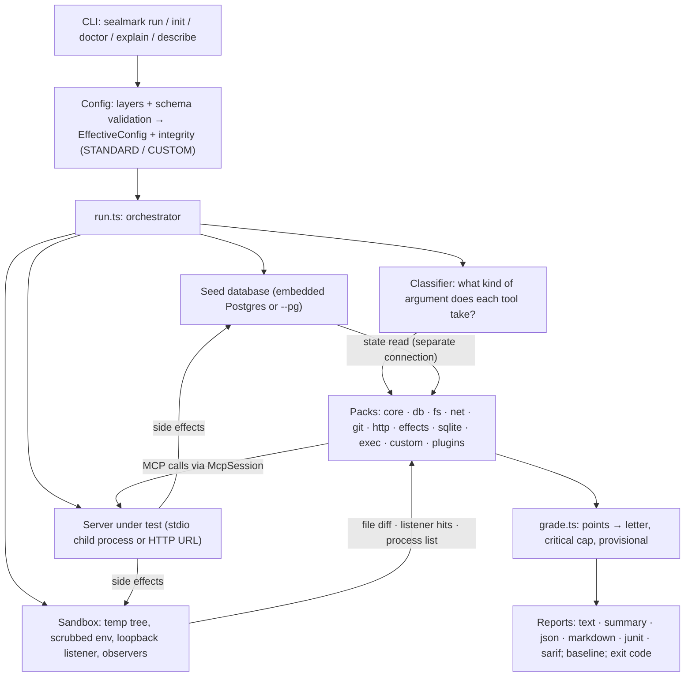

# Sealmark architecture

How Sealmark works and why it was built this way. Written against the 0.3-draft build (methodology `0.3-draft`; `0.2-draft` was the methodology of CLI 0.2.0 and 0.2.1, and the standard hash changed with the bump, see section 9). Where this document and the code disagree, the code is what runs; file a docs bug.

Related documents: [`methodology.md`](methodology.md) (what each check does), [`mvp-design.md`](mvp-design.md) and [`packs-design.md`](packs-design.md) (the original design contracts), [`ci-design.md`](ci-design.md) (the CI workflow), [`decisions.md`](decisions.md) (why the project exists in this form).

Contents

1. [What Sealmark is, and what a grade means](#1-what-sealmark-is-and-what-a-grade-means)
2. [Design principles](#2-design-principles)
3. [System overview](#3-system-overview)
4. [The life of a run](#4-the-life-of-a-run)
5. [Components](#5-components)
6. [The verdict model](#6-the-verdict-model)
7. [Trust model and what the harness touches](#7-trust-model-and-what-the-harness-touches)
8. [Design decisions and the alternatives we rejected](#8-design-decisions-and-the-alternatives-we-rejected)
9. [Extension points](#9-extension-points)
10. [Known limits](#10-known-limits)
11. [Code map](#11-code-map)

---

## 1. What Sealmark is, and what a grade means

Sealmark is a test harness for MCP servers. It starts a server (or connects to one that is already running), calls its tools with fixed, published inputs, checks what really happened, and prints one letter grade (A to F) per pack, with the evidence behind every check.

**An A means the server passed these specific, published probes with this exact configuration.** It is not a security endorsement. It says nothing about what the probes do not cover, and every report lists what was not covered. `core` alone is hygiene only; a core A is never badge-eligible.

The question Sealmark answers is not "what does this server say it does?" (that is what a schema scanner reads) and not "how well does a model use this server?" (that is what agent benchmarks measure). It answers: **"when something calls this server's tools the way an agent would, does the server behave the way it should?"** That is a behavioral question, so the harness has to run the server.

---

## 2. Design principles

Every structural choice in the codebase traces to one of these.

1. **No LLM in the loop.** The harness is an ordinary MCP client that sends fixed calls. The same server version, configuration and seed produce the same verdicts and evidence on any machine. The rendered, redacted report is stable too: the listener port (in every spelling of a loopback host it appears next to, in evidence, the Markdown report and the text report's sandbox line, which prints `{listener_port}`), the sandbox path (plain, percent-encoded and backslash-escaped) and the per-run random tokens (`sm-<hex>`, the `who` token, canary and control values, the `sm-control-<hex>` and `pwned-<hex>` markers, and a token inside a file name such as `w-sm-<hex>-3.txt` or `w-ctl-sm-<hex>-abs.txt`) are rewritten to fixed placeholders under redaction, in every position they occur (`--no-redact` or a kept sandbox shows the real values); the sandbox path is rewritten in every spelling too, including a truncated echo of its directory name, the `file://localhost/<dir>` form and the `%2F` and `%5C` spellings; fixture commit dates are fixed so commit SHAs repeat, and a commit id or range in an excerpt prints as `{sha}`. Two runs of the same server produce the same verdicts and evidence. Text, markdown, summary, badge and shields output is byte-identical at every verbosity. In the JSON exactly three of the harness's own fields differ, `startedAt`, `durationMs` and `sandbox.listenerPort` (the JSON keeps the real port, and timestamps and durations differ per run by nature), and a fourth, `upstream.url`, when an upstream stub ran; with `probes:` declared, the measured time of each valid call (`probes.calls[].elapsedMs`) differs too. The stub's port, the minted bearers (`{bearer:a}`, `{bearer:b}`), the reply rows the stub mints and the sql-guard and scope corpus tokens are rewritten like the listener port and the other tokens; JUnit and SARIF differ in the same fields plus the SARIF `startTimeUtc`, and any timing the server itself prints inside an excerpt can differ in those three formats. One harness-measured number can differ in every format: how many bytes the net pack's listener had sent when a server hung up early on the oversized reply, printed as `under N of 64 MiB` with N rounded up to a power of two from 8. `config.path` is stored relative to the working directory. A grade a maintainer cannot reproduce is not a grade they can act on, and a result that depends on a model's mood cannot be argued with.
2. **Verify side effects, not claims.** A server's own response is the weakest evidence: a server can say "rejected" and still write the row. Wherever possible the harness observes the effect directly: it reads the database over its own connection, diffs the sandbox file tree before and after, listens on a loopback port for connections the server was tricked into making, and lists the server's process tree. The verdict comes from what changed, not from what was said.
3. **Only probe things the harness owns.** Probes point at a disposable database, a temporary directory tree, and a loopback listener that Sealmark created. Nothing is sent to your real files, hosts or credentials. The harness never sends valid-looking input to a tool it could not classify.
4. **Behavior over declarations.** Tool schemas and annotations describe intent. Sealmark checks them against behavior (for example `readOnlyHint: true` is tested by watching for writes).
5. **Honest labels.** Every result records the exact configuration. A run is labelled **STANDARD** only if every grade-affecting setting equals the published profile; any other run is **CUSTOM**, with the differences listed. A grade never claims more than it earned: inconclusive checks leave the denominator and mark the grade provisional; an unscored pack produces no letter rather than an invented one.
6. **Local-first and simple to run.** One `npx` command, no account, no service, no Docker. Embedded Postgres is started for you. Configuration is optional and every setting can come from a flag, an environment variable or a file, so a CI job needs one file at most.
7. **Modular by pack.** Each area (files, network, git, HTTP, SQL, effects) is a self-contained pack with the same interface. Adding coverage means adding a pack, not changing the engine.
8. **Fail loud on the harness, not the server.** A bad config is exit 2, a server that cannot start is exit 4, "nothing could be graded" is exit 3. A gate never goes green because something silently stopped running.

---

## 3. System overview



Three ideas organize the system:

- **The harness owns the world the server runs in** (database, sandbox, listener). That is what makes side effects observable and results reproducible.
- **Packs ask questions; observers answer them.** Packs decide which probe to send and how to interpret evidence. Observers (database state reader, file observer, listener, process observer) are shared infrastructure that records what actually happened.
- **Grading and reporting are pure functions of the check results.** They contain no knowledge of any specific check beyond `critical` and `advisory` flags.

---

## 4. The life of a run

`runHarness()` in `cli/src/run.ts` is the orchestrator. In order:

1. **Resolve configuration.** Flags, environment and files are merged into one `EffectiveConfig`, validated against a schema, and compared with the published standard profile to decide STANDARD or CUSTOM (section 5.1). All config errors are reported together and exit 2 before anything starts.
2. **Load plugins** (if any), so a bad plugin module is a config error and does not cost a server start.
3. **Start the seed database** when it is needed: embedded Postgres by default, or an external instance with `--pg` (which requires a superuser and `--yes`). A database is started whenever the server's config uses placeholders, because such a server cannot start without a connection string.
4. **Create the sandbox** (stdio servers and HTTP servers Sealmark starts, unless `--no-sandbox`): a temp tree with a root, a sibling "evil root", a canary directory the server is never told about, a private HOME and TMP, and a `bin` directory of harness-owned programs. Start the loopback listener. Build a scrubbed environment for the server. Create fixtures (for example a git repository) that the config refers to.
5. **Start the upstream stub and mint the identities** when the config asks for them (round 6): with `upstream.kind: http` and `{upstream}` in the server config, a harness-owned HTTP stub on loopback becomes the server's backend; `{bearer:a}` and `{bearer:b}` get a minted token each (or `identities.a`/`.b`). **Launch the server** if the config says `command` plus `url` (Sealmark starts it, waits until the URL gives a real answer, and stops it at the end): it is started inside the sandbox like a stdio server (working directory `root`, the scrubbed environment unless `sandbox.scrub_env` is off) and its output feeds the server log. Otherwise an HTTP server is used as given.
6. **Open a discovery session.** One session on the server runs `initialize` and `tools/list` (following pagination) and records the tools.
7. **Classify the tools** (section 5.3) and apply `tools.include`, `tools.exclude` and overrides. Validate any custom probes before the first call, so a typo costs no server time.
8. **Run `core` first** (the valid calls of `probes:` first, so they count toward coverage), then each other pack that applies, in the order `http`, `fs`, `git`, `net`, `sqlite`, `exec`, `scope`, `sql-guard`, `upstream`, `effects`, `custom`; a candidate pack whose declaration exists is added to a pack list nobody chose (`autoAddedPacks` in `doctor.ts`, which `doctor` uses too). After the packs, the advisory `refusal-quality` reads every refusal they recorded. A pack's `applies()` returns either `ok` or a reason; a pack that does not apply is reported as not applicable with that reason, never silently skipped. Each pack has its own timeout. Packs get fresh sessions started inside the sandbox (over HTTP, a fresh MCP session on the one launched process); the db pack starts one server instance per database role. The stub goes back to its normal answers after every pack; packs read it by mark, so its record is kept.
9. **Grade.** `gradePack()` turns each pack's checks into points, a letter, a critical cap and a provisional flag (section 5.8).
10. **Assemble the result**: configuration identity and standard differences, coverage level (section 6), badge eligibility, what was not covered, warnings, the tool classification, and, for an `npx` or `uvx` server, the resolved package. The resolved package is read from the package-manager cache without running anything and is never a version the process did not run: with one cached version that version is reported; with several, the version the server announced in `serverInfo.version` picks among them, and otherwise the report says `unknown` and lists the candidates (a pinned spec narrows the choice first). A single cached version that differs from a package-style version the server announced is printed with a warning.
11. **Clean up in `finally` and on SIGINT/SIGTERM/SIGHUP**: close sessions, stop the launched server, kill stray processes and process trees, destroy the sandbox (retrying for a few seconds), drop seed roles and database (for `--pg`), stop embedded Postgres. After a signal the order is: close the sessions (so in-flight calls return), stop the server, sweep the children (every registered Postgres pid is kept out of the sweep, see below), wait up to three seconds for the pack that was running, then destroy the sandbox, tear down the database, stop the embedded Postgres through its registry (below), sweep again, and remove the sandbox once more if it reappeared. No server is started after the signal (opening a session throws "the run was interrupted, so the server was not started again"), so the `db` pack does not start the next role. If the signal arrives while the embedded Postgres is starting, the run re-checks the interrupt flag the moment the start returns, stops the new handle at once and throws, and the provisioning steps stop between steps. The bounds under an interrupt are 3 s for terminating database backends, 5 s for a polite `stop()` before the kill ladder, 3 s for the in-flight call and under 12 s for the whole of `cleanup`; the 15 s bail in `launch.ts` prints `cleanup did not finish: <the registered data directories> (remove it by hand)` synchronously before it exits, so that line is never missing. If a directory is still there, stderr names it. A hard kill (SIGKILL) can leave a temp dir behind; the report says when cleanup did not finish.
12. **Report and exit** (section 5.9). Reports are rendered from the result; the exit code is decided from the grades and the gate options. A run that was stopped by a signal ends with `sealmark exit 130: interrupted` (the signal's own code) instead of the gate line, even when the signal arrived as the last pack finished, so the printed code and the real exit code agree; `RunResult.interrupted` is `true`, with the warning "the run was interrupted; the report may be incomplete" in the JSON and the JUnit properties. With `--keep-sandbox` an interrupted run ends with `kept sandbox: <path>`, and `sandbox.cleanedUp` is `false` whenever the sandbox was kept.

---

## 5. Components

### 5.1 Configuration (`cli/src/config/`)

**Goal:** every setting is reachable by flag, environment variable or file, defaults do the right thing, and every value has a recorded origin.

- **Layers, lowest to highest:** built-in defaults → the selected profile (`standard`, `ci`, `quick`, `strict`, `paranoid`, or a user profile) → user-level file → project `sealmark.yaml` (plus an optional `sealmark.local.yaml`) → `SEALMARK_*` environment variables → CLI flags. Scalars replace, maps merge, lists replace unless the schema marks them mergeable.
- **One schema table** (`config/schema.ts`) defines every key: type, default, description, which version added it, whether it affects grades (`standardLocked`), whether it is a secret. The JSON Schema, the validation, the generated `standard.yaml` profile and the reference docs are all generated from it, so they cannot drift apart.
- **Strict validation** with did-you-mean for unknown keys, file and line in every message, all errors collected at once.
- **Origins.** `sealmark config show --origins` annotates every effective value with where it came from.
- **Integrity** (`config/integrity.ts`). Every setting that can change a grade is marked locked. A run is STANDARD only when all locked values equal the standard profile, no standard pack was removed, and no plugin or custom check is in play. Adding coverage (an extra pack, a probe with no check) does not make a run custom, because adding coverage never weakens a grade. A hash over the locked values, the methodology version and the standard packs identifies the configuration, so two runs with the same hash are comparable. The ids of custom checks and the plugin modules enter the hash too, but only when there are any (an empty set is left out, so a run without them keeps the published standard hash): a run with checks the standard does not have is not comparable with one without them. `--baseline` and `diff` then say "different configuration", and `--replay` of such a report restores the locked settings only and warns that the probes must be declared again.

- **Two unlocked keys add coverage and never weaken a grade** (round 5), so a run that sets them stays STANDARD and the standard hash does not move: `server.rootless` (boolean, default `false`) says "the server takes no root argument; the `fs` pack treats its working directory, `{sandbox}`, as the allowed root", and `sql_tools[].args` (a map of scalar values) gives the other required parameters of a SQL tool the values a placeholder token cannot satisfy. `doctor` and the `fs` n/a reason suggest `server.rootless` when medium-or-higher path tools exist and no `{sandbox}` placeholder does. An unknown `{word}` placeholder in `server.command`, `args`, `env`, `url` or `headers` is a warning at load (with a did-you-mean), because a server may legitimately take braces; a `tools.overrides.<tool>` class with no usable parameter for it is a config error (exit 2) that names the fix.

*Why:* a grade is only meaningful if you can say exactly what produced it. Making "loosened a threshold" or "disabled a check" visible in the report, and making such a run ineligible for a badge, lets people tune Sealmark for their own needs without devaluing the published standard.

### 5.2 The MCP session (`cli/src/mcp.ts`)

A thin wrapper over the official MCP SDK client (stdio and Streamable HTTP). It exists to make failure modes explicit, because a conformance tool must tell "the server misbehaved" apart from "the harness gave up":

- **Call results carry structure**: `isError`, text, elapsed time, `timedOut` (the harness stopped waiting), `rpcError` (a JSON-RPC level error, which is a reply and not a timeout) and `closed` (the process or connection went away).
- **Hard limits**: a 64 MiB message cap so one oversized response cannot kill the transport and read as a pass, pagination capped at 50 pages and the whole `tools/list` at 5 000 tools and 32 MiB of serialized pages (past either, a protocol violation that the `protocol` check reports, so a server that floods the listing cannot exhaust the harness's memory), bounded stderr capture.
- **Non-text content is carried**: `CallResult.blobs` holds the resource, image and audio blocks of a reply, decoded (up to 8 MiB per result; beyond that only the byte count), so the `fs` and `net` packs can look for a canary or a decoded `data:` URL inside a block. The text rendering is unchanged, so no other pack sees a difference.
- **Orphans**: once the connection is up the session remembers the server's process tree (each pid with its command line). When the launcher (`npx`, `uvx`) exits before its child, `close()` still stops the remembered descendants whose current command line equals the remembered one, which is the pid-reuse guard.
- **A server that answers with something no valid client can parse** is a protocol violation (a finding), not a harness failure. Since round 5 the session also counts the lines a stdio server wrote to stdout that are not JSON-RPC (the SDK reports every unparseable line) and the tool results the SDK rejected as not valid MCP, with the first of each kept (bounded and sanitised); the `protocol` check reads both from the core session.
- **Model-visible text beyond the tool list**: the session keeps the server's `instructions` and the `serverInfo` fields `name`, `title`, `description` and `websiteUrl`, so `tool-poisoning` can scan them with the same tiers as a tool description.
- **Dependency-drift hints** when stderr shows an import or module failure under an unpinned launcher.
- **Environment control**: stdio servers can be started with a complete scrubbed environment and a chosen working directory.

### 5.3 The classifier (`cli/src/classify.ts`)

Most MCP servers are not databases. The classifier decides, per tool, what kind of argument it takes: `sql`, `path`, `url`, `command`, `git`, `text` or `opaque`, with a confidence (`low`, `medium`, `high`, `explicit`) and the reasons.

It looks at parameter names, JSON Schema types and formats, tool names and descriptions, and annotations. Only string parameters and arrays of strings count. The result gates which packs may probe the tool:

| Confidence | Which packs may use the tool |
|---|---|
| low | `core` only (schema-invalid input only) |
| medium | `fs`, `net`, `git`, `effects` (their inputs are harness-owned, harmless to any tool) |
| high or explicit | also `exec`, and only with `--active` |

When several candidates match, the one with the strongest evidence wins: a parameter that declares its kind (a `format: uri` or `format: url` parameter) outranks a generic parameter plus a hint in the tool name, and the fixed specificity order (`command`, `sql`, `git`, `path`, `url`, `text`) only breaks ties between equal-strength candidates. When two candidates reach `medium` with equal strength both are recorded (primary and secondary), so a tool is never probed as a path tool and silently denied the network pack: the classification keeps the secondary candidates' parameters (`secondaryParams`), `packsFor` adds `net` for a secondary `url` that has a `url` parameter, and the `net` pack builds its target for such a tool with the url slot filled by the probe and every other required parameter by its filler (the report prints `secondary: url (probed by net)`). Only `url` is consumed: a secondary `path` or `git` would aim write probes at a tool whose primary slot then holds a harness token, which can only produce a vacuous pass, so those are listed under "not covered" (`also looks like a path tool (secondary class); only its primary class (url) was probed`). The words "git-style" in a description are not a `git` signal.

A required parameter that is declared as a boolean or a string (`type: ["boolean", "string"]`) is filled with `false`, not a token: a boolean is a member of the union and a token is not what a server that validates the union accepts.

Round 5 widened what the classifier sees without changing what it trusts. A string parameter whose normalised name ends in `path`, `file`, `filepath`, `filename`, `dir` or `directory` is a strong path parameter, and a name that starts with `destination`, `dest`, `target`, `to`, `output` or `new` makes it a destination (`source`, `src`, `from`, `input` make it a source), so `outputPath` and `source_path` are recognised. An array whose items are an enum is filled with the first value (`[enum[0]]`), so a tool whose only unfillable parameter was an enum array is fillable. The classifier descends one level into an object or an array of objects: a strong path key inside `items.properties` makes the tool "would be path (param `files[].file_path`), but required parameter `files` cannot be filled by the harness", which the `fs` pack reports as inconclusive rather than "no tool reads"; an object parameter whose required sub-properties are all fillable scalars is fillable, which is what lets an edit tool with `edits: [{oldText, newText}]` be called. A hint in the tool description alone no longer promotes a generic parameter to medium: the hint must be in the tool name, the title or the parameter's own description. The core-only note says which class was chosen ("free-text parameter: no path, URL, command, SQL or repository signal").

Users can override the classification (`tools:` in config), or exclude tools. Every classification and its reason is printed in the report, and low-confidence tools are listed under "not covered" with how to include them: a heuristic guess says to add the tool under `tools:`; a tool that is already overridden to a class no pack probes, or whose required parameters the harness cannot fill, says to write a `probes:` entry to call it, because an override does not make an object parameter fillable.

*Why:* the alternative is to send probes to every tool and hope. That is unsafe (a destructive tool could receive a plausible path) and noisy. The classifier makes the harness conservative by default and makes its reasoning inspectable.

### 5.4 The sandbox and observers (`cli/src/sandbox.ts`, `cli/src/observers/`)

The sandbox is a disposable directory the harness creates for each run:

```
<tmp>/sealmark-<random>/
  root/        the server's working directory and "allowed root"
  root-evil/   a sibling whose name starts with the root's name (prefix-check bugs)
  canary/      secret files and a repository the server is never told about
  home/ tmp/   private HOME and TMP for the server
  bin/         harness-owned programs (sm-canary, sm-echo, sm-sleep, sm-spew)
```

The directory is created with mode 0700 on POSIX (round 3), so another local user cannot read the canary files or the private HOME; `--fixture` output is not restricted, because a hand-run fixture is meant to be inspected. The server is started with its working directory in `root`, a scrubbed environment, and `HOME`/`TMP` pointing inside the sandbox. What is inherited is a short, fixed list (the system part of `PATH`, `LANG`, and the package-manager cache locations `npm_config_cache`, `UV_CACHE_DIR` and `UV_PYTHON_INSTALL_DIR` when they exist), and the sandbox line of the text and markdown reports prints it (`inherited: PATH (system part), LANG, ...`); the JSON carries it as `sandbox.inherited`. A probe that tries to escape (`../canary/secret.txt`, a symlink, an absolute path, an encoded variant) can only succeed by reaching the canary, and the canary is a random string the harness can recognize anywhere.

Six observers record what actually happened:

| Observer | Records | Used to decide |
|---|---|---|
| File observer | Snapshot (path → size, mtime, content hash) of root, evil root, canary, home, tmp; diff before and after | Did a write escape? Did a "read-only" tool change anything? |
| Loopback listener | Every TCP connection and HTTP request on `127.0.0.1` (and `[::1]`), with a per-probe token; also serves large and slow responses | Was the server tricked into connecting out (SSRF)? Did it follow a redirect? |
| Process observer | The server's process tree before and after a pack; strays under the sandbox | Did the server leave processes behind? Did a command run? |
| Database state reader | A separate admin connection to the seed database | Did the row, table or value actually change? |
| Upstream stub (`observers/upstream.ts`, round 6) | Every request the server makes to its backend at `{upstream}` (method, path, query, headers, body up to `upstream.max_body_kib`), answered from `upstream.responses`, `upstream.default_reply`, a probe's `upstream.reply`, or the `error` and `slow` modes the upstream pack sets; `{upstream_token}` in a reply mints a marker per occurrence | Did an out-of-scope name or a forbidden statement reach the backend? Whose credential did it carry? Was a reply row echoed? Loopback only, never proxies |
| Server log (`observers/log.ts`, round 6) | The last 1 MiB of what a server Sealmark started printed (stdout and stderr), or of a stdio server's stderr | Did the server log a caller's token? |

**What the sandbox is not.** It is a convention the harness follows, not a security boundary. A malicious server runs with your user's privileges and can ignore its working directory. Run unfamiliar servers in a throwaway VM or container. This sentence is printed in reports and repeated in the docs on purpose.

### 5.5 The database subsystem (`cli/src/seed.ts`, `cli/src/embedded.ts`, `cli/src/packs/db.ts`)

A fixed synthetic Postgres database, `sealmark_seed`:

- Two tenants with row-level security policies, fake personal-data columns, a large table for row-cap tests, a scratch table for mutation probes, and an audit table.
- Three login roles: `analyst`, `support`, `admin` (`sm_<role>`), non-superuser and non-bypass-RLS, with different grants.
- Embedded Postgres by default (an optional dependency; a real Postgres process on loopback with a temp data directory and a random admin password). With `--pg`, an external instance (superuser and `--yes` required; the harness creates and drops the seed database and the three roles).

**One server instance per role.** A database-backed server usually takes one connection string and has no concept of callers. To test it as three roles, Sealmark starts the server three times, each with a different connection string substituted for the `{dsn}` placeholders in its command, arguments, environment, URL and headers. Whatever the server does, it does it as that database role.

**Verification by state.** Probes send mutating SQL (a 19-case corpus of inserts, updates, deletes, DDL, `DO` blocks, writable CTEs, `PREPARE`/`EXECUTE` as two calls and as one, functions with side effects in the select list and in `FROM`, `EXPLAIN ANALYZE` of a write, case and comment obfuscation, multi-statement input, and a transaction terminator followed by a write for each of `COMMIT`, `ROLLBACK`, `END` and `ABORT`), cross-tenant reads, and personal-data reads. The verdict comes from the state reader: was a row written, a table dropped, another tenant's row returned, an email unmasked. A server that says "rejected" and writes the row fails.

**Does the server use the credentials it was given?** Every credential comes from the harness, so "does the server connect as a superuser" is fixed by construction. What can be observed is whether each of the three instances connects as exactly its own role. The advisory candidate `db-privilege` opens the instances one at a time and compares the new database backends and `SELECT current_user` with the role in the instance's `{dsn}`. A server that reuses a cached connection string used to surface only as "all checks inconclusive"; it now fails this check by name. It is advisory because scoring it would give every well-behaved server one more near-automatic point and move letters up (see `methodology.md` section 6.8).

*Why Postgres first, and embedded:* Postgres has the strongest, best-known controls (row-level security, role grants, column privileges), so a failure is unambiguous and attributable. Embedded means no Docker and no account, which keeps the first run to one command.

### 5.6 Packs (`cli/src/packs/`)

A pack is an object with three methods:

```ts
interface Pack {
  id: PackId;
  describe(): CheckDoc[];            // the published checks: probes, thresholds, false-positive/negative notes
  applies(ctx: PackCtx): PackApplies; // { ok: true } or { ok: false; reason }
  run(ctx: PackCtx): Promise<CheckResult[]>;
}
```

`PackCtx` gives the pack its tools, the classification, the sandbox and observers, a way to open fresh sessions, timeouts, and the results of earlier packs; since round 6 also the upstream stub (`upstream`), the server log (`serverLog`), per-caller sessions (`identity.openAs("a" | "b" | null)`) and the harness placeholder values (`vars`), each undefined when the run has none. A pack never reads YAML or `process.env`; it sees only the effective config.

| Pack | Applies when | Examples of what it checks |
|---|---|---|
| `core` | always | MCP handshake and schemas, and whether stdout carries only JSON-RPC; tool-poisoning indicators in tool metadata, the server instructions and `serverInfo`; survival of malformed input (a rejection that came after the argument was used is leniency); environment-secret echo (canary variables) |
| `db` | SQL tools and `{dsn}` placeholders | read-only by default; row-level security; mutating-SQL corpus (19 cases, four transaction terminators); personal-data masking and a readable masked view; row cap and statement timeout (`db-rowcap`, `db-timeout`); write gate, audit and the `db-privilege` candidate (advisory) |
| `sqlite` | the server config has a `{sqlite_path}` placeholder, stdio, sandbox on, and the engine answers `sqlite_version()` | the same questions against a harness-owned SQLite fixture file; file reads and writes in several forms (single-call, stacked, copy into a fixture table, `VACUUM INTO`, `ATTACH`); a server whose engine is not SQLite is inconclusive on every check, never graded |
| `fs` | path tools, a server the harness starts (stdio, or `command` with `url`), sandbox on (or `server.rootless: true`) | read, write and link escapes from the root (the write corpus mirrors the read corpus; array, backslash, move-through-link and edit-tool families); size cap |
| `net` | URL tools, including a secondary `url` class | loopback SSRF (a refusal must tie itself to the target or the rule, and a hostless twin probe decides whether refusal text describes the target); scheme allowlist; response caps (size judged by the bytes the server consumed); redirect re-validation (`net-redirect`, scored, not critical) |
| `git` | git tools, `git` installed, and `{sandbox}` in the config | repository scope (the fixture stages a change, plants a link, and has a remote and a tag; read tools are aimed at other repositories with absolute and relative paths and every read tool must be judged; write tools are judged by observation); argument injection |
| `http` | an HTTP server | origin validation, auth, protocol version, sessions, CORS (a redirected preflight is inconclusive); bind and TLS (advisory) |
| `effects` | tools with annotations, or unannotated read-style tools, that take a harness-owned target (a path, a repository, a URL or no argument) | annotation honesty (does a `readOnlyHint` tool write?), open-world honesty, undeclared writes inside the observed sandbox directories; `n/a` for a URL tool that refuses loopback targets |
| `exec` | command tools, **opt-in `--active`** | shell-injection in arguments, working directory, timeout and output caps, allowlist |
| `scope` (candidate) | `scope.tools` names a tool the server declares, and `scope.allow` is not empty | `scope-escape`: identifiers outside the declared scope, in every spelling of the corpus, are refused and never reach the upstream stub |
| `sql-guard` (candidate) | a SQL tool and an upstream stub | `sql-guard-statements`, `sql-guard-references`, `sql-guard-rowcap`: token-canary SQL, judged by what reached the stub (no SQL parser in the harness) |
| `upstream` (candidate) | an upstream stub and at least one valid call | `upstream-credential`, `upstream-credential-echo`, `log-secret`, `upstream-error-leak`, `upstream-slow` |
| `custom` | `probes:` with a `check:` in config | user-defined probes with expectations on responses, side effects, the upstream stub and the server log |
| `plugin:<name>` | declared under `plugins:` | anything, labelled as custom |

`effects` is its own pack because "declares versus does" cuts across tool classes, and folding it into `core` would have changed frozen results. Whether it applies is decided by `effects.ts` `applies()`, and the reason it prints when it does not (for example, no tool declared `readOnlyHint: true` that could be given a harness-owned control argument) comes from one function, `effectsGateReason(classification, { active, sandboxEnabled })`, exported by `effects.ts`: `applies()`, `run` and `doctor` all take the wording from it, so there is one wording and no copy to keep in step (before round 3 `run` and `doctor` each carried a hand-copied sentence that a test pinned). `doctor` says `may run`, not `would run`, because applicability depends on controls that only a run establishes.

**Effects and a guarded URL tool (round 5).** The harness owns no URL a correctly guarded fetcher will fetch, so its `effects` control fetch is refused. When `ctx.prior` holds a `net-loopback-ssrf` pass whose every probe was refused, that tool is `n/a` in `effects` ("the tool refuses loopback targets (net-loopback-ssrf passed), so no harness-owned control URL exists"), and when every subject is `n/a` the check is `n/a`. Before this, `effects` went inconclusive after `net` passed, so the `ci` profile, which fails an inconclusive pack, could never be green for a correctly guarded fetcher; now it can. A tool with no required parameters and `readOnlyHint: true` gets `{}` as its control, observed like any other, and a lying no-argument tool fails `annotation-honesty`. The pack runs when any usable tool is annotated or an unannotated read-style tool exists; `annotation-honesty` and `openworld-honesty` are `n/a` when nothing is annotated, and `undeclared-writes` still runs.

**Which packs run.** The default pack list is every standard pack; `custom` is appended to it when the config has a probe with a `check:`. A list the user chose (`--pack`, or `packs:` in a file) is used as written: if it omits `custom`, the probes are skipped and a warning in the report and in the JUnit properties says so, rather than the engine adding a pack the user left out (decision D28). A pack that cannot run because of the harness's own environment (for example `node:sqlite` is missing) is recorded `inconclusive`, so the `ci` profile fails it and the default gate warns, whereas a pack that does not apply to the server is `na`. `doctor` prints the same `packs applied` line as `run`, `core` included once the server started.

### 5.7 Custom probes and plugins (`cli/src/probes.ts`, `cli/src/plugins.ts`)

Two escape hatches, both labelled CUSTOM in the report:

- **Custom probes** are declarative: a tool, arguments with placeholders (`{sandbox}`, `{canary}`, `{listener}`, `{token}`, `{dsn:role}`), and expectations (error or not, text patterns, files unchanged or created, listener hit or not, duration; round 6 adds what the upstream stub received, what the server logged and the reply size, plus `identity`, `matrix`, `cases` and a scripted `upstream.reply`). They observe the sandbox, the stub and the server log. A probe without a `check` is just a valid call that counts toward coverage and feeds the secret-echo scan.
- **Plugins** are ES modules that implement `Pack`. They run in-process with the same trust as the config file that declares them, receive helper functions rather than imports (round 6 adds `helpers.upstream`, `helpers.serverLog` and `helpers.openAs`, undefined when the run has none), cannot change another pack's results or the grading formula, and make the run CUSTOM.

### 5.8 Grading (`cli/src/grade.ts`)

Grading is a small pure function. For one pack:

1. Take non-advisory checks. A check is *scored* if its verdict is `pass` (1 point), `part` (0.5) or `fail` (0).
2. If nothing is scored there is **no grade** (the pack is `na` or `inconclusive`, with the reason). A letter is never invented.
3. Percentage = points ÷ scored. Raw letter: A ≥ 90, B ≥ 75, C ≥ 60, D ≥ 45, otherwise F.
4. **Critical cap:** a `fail` on any critical check limits the letter to D. A `part` on a critical check does not trigger the cap.
5. **Provisional:** an `inconclusive` critical check marks the grade with `*`, because a critical question is unanswered.
6. Checks that are `inconclusive` or `na` leave the denominator and are listed. Advisory checks are shown and never change the letter.

Grades are per pack and per server version, and are never inherited between versions.

**A provisional grade does not meet the A gate** (round 3, decided by recommendation, owner may veto). Grading itself does not change: a provisional A is still graded A and printed `A*`. The rule lives in the exit-code step (`report/exit.ts`), not in `grade.ts`: with `--fail-under A` (the default), a graded pack whose letter is A but is provisional is below the gate, because an A claims that every critical question was answered. Lower gates are unchanged (a provisional B meets `--fail-under B`). The score fraction printed beside a grade is one helper used by the text, markdown and summary renderers: points over scored checks (`3/4 points, 75%`), plus `1 of 5 checks not scored` when a check was excluded.

*Why a letter with a cap:* a single letter is what makes a result easy to gate in CI, show on a badge, and remember. The critical cap exists so a server that leaks personal data or lets a mutation through can never show an A just because it passed the other checks. Points move in halves, so the division is exact at every letter boundary and results do not depend on floating-point rounding.

### 5.9 Reports, exit codes and baselines (`cli/src/report/`, `cli/src/cli.ts`)

One `RunResult` object is rendered into six formats: `text`, `summary` (a short human view: grade cards, a check table, what to fix), `json` (the full machine-readable record), `markdown`, `junit`, and `sarif`. Output goes through a sanitizer (terminal control characters, markdown and XML escaping) and a redactor (secret-looking values and URL credentials are never printed). A check line has one verdict tag (`[PASS]`, `[PART]`, `[FAIL]`, `[INCL]`, `[N/A ]`); an advisory check ends with `(advisory, not scored)`. `sealmark config show` is the pre-run view of the integrity decision (section 5.1): its first line is a YAML comment, `# STANDARD: every grade-affecting setting equals the published profile (hash sha256:…)` or `# CUSTOM: 2 settings differ from the standard profile: …`, built from the same integrity record the run uses, and `--json` carries it as an `integrity` object.

Exit codes:

| Code | Meaning |
|---|---|
| 0 | ok |
| 1 | a graded pack is below `--fail-under` (a provisional `A*` is below an A gate), an inconclusive pack counts as failing (`output.exit_policy.treat_inconclusive_as: fail`, which the `ci` profile sets), or a pack regressed against a baseline |
| 2 | usage or configuration error |
| 3 | no pack was graded |
| 4 | the harness or the server failed to run |
| 129, 130, 143 | the run was stopped by SIGHUP, SIGINT or SIGTERM (128 plus the signal number), after cleanup. The last line on stderr is `sealmark exit 130: interrupted` (with the signal's own code; `stopped` instead of `interrupted` for SIGTERM and SIGHUP), even when the signal landed as the last pack finished, so the line printed and the code returned never disagree |

With several servers the exit code is the worst of them. A gate cannot look green while a requested pack could not be judged.

**The stderr grade line.** When the console does not already show the grades (the report went to a file, or the format on stdout is a machine one), the run prints one line per server on stderr, then any configuration warning not printed before the run. The rule is "unless the text or summary report was rendered to stdout", not "unless `summary` is among the formats", so `--format summary --out <file>` still gets the line. The line names a critical fail whether or not it capped the grade (`db F critical fail: mutating-sql`; `db D capped: critical fail: mutating-sql` when capped) and a critical check at `part`, which does not cap, as `critical part: <id>`, so a grade of C built on a half-passed critical check is not hidden. `--fail-under none` keeps the inconclusive warnings and, under `treat_inconclusive_as: fail`, says that the exit code is tied to the gate.

**Locations.** SARIF results and JUnit test cases point at the configuration file, at the line of the selected server's `command` or `url` setting when that is known (otherwise line 1). That locates the server block, not the cause of a finding.

**Baselines.** A JSON report from an earlier run can be supplied as a baseline; a regression is a check whose verdict dropped, a pack whose letter dropped, or a pack that was graded before and is not graded now. New checks and improvements are never regressions. This lets a team adopt Sealmark on an existing server without fixing everything first, and still block new regressions.

### 5.10 Launching HTTP servers (`cli/src/launch.ts`)

`command` plus `url` means "start this server, wait for it, test it, stop it". It replaces the background process, wait loop and cleanup that every CI job used to hand-write. Safety rules: the process is registered the moment it is spawned (a Ctrl+C while waiting still stops it); a server already answering on the URL before the start is an error (otherwise a leftover would be graded); "ready" means a real answer (not 404, not 5xx); errors that waiting cannot fix fail at once; a process that dies later in the run is reported. Since round 6 the server is started inside the sandbox (`cwd`, `baseEnv`), its output feeds the log observer, and its process tree is not a stray of the `exec` pack. "Started with your full environment and no sandbox" is printed only when the sandbox is off.

---

## 6. The verdict model

Each check returns one verdict:

| Verdict | Meaning | Scored? |
|---|---|---|
| `pass` | the server behaved correctly | 1 point |
| `part` | partly correct (for example masked by one tool, unmasked by another) | 0.5 |
| `fail` | the server misbehaved | 0 |
| `inconclusive` | the harness could not tell (the control read failed, nothing was captured) | excluded, and critical ones make the grade provisional |
| `na` | the check does not apply (and says why) | excluded |

Every piece of evidence records **how it was established** (`verifiedBy`): `db-state`, `fs-observer`, `listener`, `process`, `http`, `response`, `protocol` or `static`. Observation-based evidence outranks response-based evidence, and each check states its **scope** (does it measure the server's behavior, or a database control tested through the server?).

Most checks begin with a **control**: a benign call that must succeed (read an allowed file, fetch the control URL, read a permitted row). If the control fails, the escape probes prove nothing, so the verdict is `inconclusive` and not a pass. This is the main defense against vacuous passes.

A **refusal** is evidence only when it ties itself to the target or to the rule that refused it. A control that a good server cannot satisfy by construction (the harness owns no target a correctly guarded URL tool will fetch) means some checks, above all the `net` ones, must pass on the responses, so the harness rests the verdict on what it observed (no connection on its listener, a control fetch that worked, a reply that changes when the target is taken away) and uses words only to sort replies that evidence has already admitted. A reply that reports a failed fetch, or names the mechanism that failed (a proxy, a socket, DNS, a timeout, "refused to connect"), is a failure whatever adjectives it uses, because a tool that fetches nothing says exactly that.

Each loopback probe's reply is judged in nine steps. (1) A timeout or a closed connection is `failed`; a reply that is not declined is `answered`. (2) The reply text is stripped of every spelling of the probe URL and of every `<listener host>:<port>` spelling (bracketed and percent-encoded included): an echo of the probe is not evidence, and the port is the one thing only this run's probe carries; a bare host name is not stripped, because "cannot access localhost" is a legitimate refusal. (3) The failure veto is read over the stripped text: `failed to (fetch|connect|load|…)`, `(request|fetch|download|connection)… failed`, `refused to connect`, `could not (connect|resolve|reach)`, `unreachable`, and the socket, proxy, DNS and timeout words. (4) A **rule phrase** is a refusal ("names the rule"), and is tested before the veto on purpose: `ssrf`, `unsafe (destination|host|target|url|address)`, `resolves to` a private or non-public address, "only … allowed or permitted", "only public hosts", an egress policy, "failed validation", an invalid or unsupported scheme, "supported schemes are". "Request to a private address failed validation" carries `request … failed` and is a refusal. (5) A **class noun** (loopback, link-local, private or internal address, host or network, reserved, non-routable, "not a public address", "local network", "metadata endpoint") is a refusal ("names the address class") unless the veto is true and the clause that holds the noun carries no refusal word once the veto spans are cut out: "connections to a private address are not allowed" stays a refusal, "Failed to connect to loopback interface: ECONNREFUSED" does not. (6) Otherwise the veto makes it `failed`. (7) A refusal word and a target noun in the first 300 characters is a refusal ("refusal tied to the host"). (8) A structured validation error (`-32602`, or `isError` with a refusal, validation or cannot-access word) that names a loopback literal is a refusal ("validation error naming the address"); the veto has already returned at step 6, so "Request for 127.0.0.1 failed: access restricted" never reaches it. (9) Anything else is `failed`.

When every loopback probe was refused, the listener saw nothing and no control fetch worked, the pass would rest on text alone, so the harness sends **one more call per tool, the hostless twin**: `data:text/plain,sm-<token>`, a URL with no host. Both replies are normalised the same way (the probe URL, the listener `host:port` spellings and the token removed, whitespace collapsed, case folded, and compared as full texts, never the truncated excerpts) and compared. Rule 1, **same text**: the twin's reply equals the reply of every refused loopback probe, so the tool has one answer for everything and its refusals describe nothing: `inconclusive`, code `net.ssrf-sametext`. This needs no vocabulary, which is why it closes refuse-everything tools however they word the sentence. Rule 2, **address wording for a hostless URL**: the twin's reply differs but is itself a refusal at the class, host-tied or address tier for a URL that has no host: `inconclusive`, code `net.ssrf-incoherent`. Rule 3: otherwise the twin is coherent (a scheme refusal, a validation error that names the scheme, a different generic error, or an answered reply that the scheme check scores) and the text-only pass stands, with the summary "all N loopback probes were explicitly refused (the response said so), the listener saw no request or connection, and a hostless URL got a different reply; no fetch of any URL was shown to work (set net.control_url to confirm the tool fetches)", code `net.ssrf-text-only`. The honest limit is stated in the evidence: a guard that answers every rejection with one constant sentence, even a true allowlist guard, is `inconclusive` until `net.control_url` names a URL it fetches, because from outside it is the stub; most guards parse the URL, reject the scheme and then check the host, so their twin reply differs. A tool that answers the control URL has been shown to answer it, not to fetch it ("the tool answered the control URL"), and a lookup tool that matches hosts against configuration is told to settle it with `tools.overrides`. The scheme check passes only with at least one probe refused for the scheme, or a tool shown to fetch; a refusal "for another reason (host guard)" explains nothing about the scheme. Each evidence line names the rule that decided it, so a vocabulary miss is visible and can be argued in a bug report.

The same honesty applies to **coverage**. The coverage level (`hygiene-only`, `low`, `covered`) and the badge wording rest on calls that exercised a tool, not on calls that were made: a call counts when it was schema-valid and the server processed it. A control call counts only when it succeeded; an escape or policy probe counts when the tool's control succeeded (its refusal is the behavior under test, so refusal-only `net` probes keep their credit) and the reply was not a validation error; a reply that reports a failed upstream request never counts, with or without `isError` (for `probes:` valid calls, and for `custom` checks, the same rule applies, and so does a refusal in plain text); and a pack whose checks are all inconclusive or `n/a` contributes no valid calls whatever it reported. Coverage is a report field: no letter, verdict or badge reads `coverage.level`.

Every check also publishes its known false-positive and false-negative modes, so a maintainer can tell whether a failure is theirs.

---

## 7. Trust model and what the harness touches

- **It runs your server command**, with your privileges. The harness does not contain a hostile server; the sandbox is a convention. Use a throwaway VM or container for untrusted servers.
- **Environment.** For stdio servers with the sandbox on, the environment is built from scratch: a minimal system set, `HOME`/`TMP` inside the sandbox, whatever `server.env` sets, and the canary variables. What is deliberately inherited is `PATH` (its system part, so launchers like `npx` and `uvx` resolve), `LANG` and the package-manager cache locations that exist (`npm_config_cache`, `UV_CACHE_DIR`, `UV_PYTHON_INSTALL_DIR`, so the server is not downloaded again for every pack); the sandbox line of the report lists them (`sandbox.inherited` in the JSON). `--no-sandbox` inherits everything and disables the packs that need the sandbox. The scrubbed environment does not reach a path you wrote yourself: an absolute path in `server.args` or `server.env` outside the sandbox (a memory file, a data directory) names a real file on your machine that valid calls may read or write, so `run` and `doctor` warn about it, and `init` offers `{sandbox}/<name>` instead.
- **Credentials.** Do not put real credentials or connection strings in `sealmark.yaml`. Placeholders (`${VAR}`) and a git-ignored `sealmark.local.yaml` exist for this. Secret-looking values are redacted in every report. For per-caller tests write `Authorization: "Bearer {bearer}"` in `server.headers`: the harness mints `sm-bearer-a-<hex>` and `sm-bearer-b-<hex>` per run (rewritten to `{bearer:a}`/`{bearer:b}` in reports), and `openAs(null)` drops every header that holds `{bearer}`. `identities.a`/`.b` (secrets, `${VAR}` allowed) replace the minted tokens for a server that validates tokens it did not issue; they then reach the harness's loopback stub (its `error` mode echoes the credential it received, to detect a server that relays error bodies), and they are scrubbed from every report.
- **Database.** Probes touch only `sealmark_seed`. With `--pg` the harness runs administrative SQL on your instance (drop and create the seed database, create and drop three roles with a random per-run password), so it needs a superuser and `--yes`, and should only point at a throwaway instance.
- **Network.** The only network targets the harness ever sends a server to are its own loopback listener and its own loopback upstream stub. Link-local and private ranges are never probed. A URL tool may **relay the probe values to its own upstream**: a tool that forwards a URL, a query or a path to a hosted API sends the harness's probe text (a token, a loopback address) to that service, which the harness neither sees nor controls. `tools.exclude` keeps such a tool out of the `net` pack (an excluded tool is removed from the tools the packs probe; the setting is locked, so the run is CUSTOM), and the config of a server that talks to a paid or logged API is worth reading before the run.
- **Embedded Postgres, signals and shared memory.** Every embedded start is kept in one registry from the moment its data directory exists until `stop()` has finished: `pending` (no handle yet) and `live`. `cleanup` after a signal calls `stopAll`, so a signal that lands between the start returning and the handle being taken still finds the entry, and the sweep of child processes keeps every registered postmaster pid. A postmaster is stopped with a kill ladder: SIGINT (fast shutdown) and up to 2 s of waiting, SIGQUIT (immediate shutdown, which still releases the shared-memory segment) and up to 1 s, SIGKILL last; the sweep of its workers runs after the postmaster is gone. SIGKILL skips Postgres's own release of its SysV shared-memory segment, and macOS allows 32 segments by default, so about 30 such runs would break every later embedded start with "could not create shared memory segment: No space left on device". So before a data directory is removed, line 7 of its `postmaster.pid` (`<key> <id>`) is read, and after the postmaster is gone the harness runs `ipcrm -m <id>` if the segment still exists (POSIX only; a missing `ipcrm` or an already-released segment is ignored). Only an id read from the harness's own data directory is ever removed; there is no heuristic over `ipcs` output. When a start fails with that message the error says that orphaned segments from earlier interrupted runs are the usual cause, and `sealmark doctor` lists segments of the current user with no attached process, a dead creator and a size under 1 KiB as "possibly orphaned", with the command to remove them, and removes nothing itself.
- **Disclosure.** A failing result for a named third-party server is a potential vulnerability report. See the disclosure policy before publishing anything.

---

## 8. Design decisions and the alternatives we rejected

| Decision | Alternatives considered | Why this choice |
|---|---|---|
| **Run the server and call its tools** | Statically scan tool schemas (as several existing scanners do) | A schema says what a tool *accepts*, not what it *does*. "Accepts arbitrary SQL" is a fact about the schema; "did read-only mode stop the INSERT" is only knowable by running it. The two are complementary, but only the second tells you whether a control holds. |
| **No LLM in the loop** | Drive the server with an agent and judge the transcript | Agent benchmarks measure the model. A harness with a model in it is non-reproducible, costs money per run, and cannot give a maintainer a deterministic repro. Fixed probes are boring and arguable, which is what a conformance tool needs. |
| **Verdicts from observed side effects** | Trust the server's response text | Responses are the easiest thing for a faulty or hostile server to get wrong. A database read, a file diff or a listener hit cannot be talked around. |
| **Harness-owned world (db, sandbox, listener)** | Probe the user's real database, files and network | Safe by construction: nothing real can be damaged, and the harness can plant canaries and recognize them. The cost is that the server must be configurable to point at the harness-owned resources. |
| **Sandbox as a convention, not a container** | Require Docker or a VM; use OS-level sandboxing | A container requirement would kill the "one command" first run and the CI story. We state plainly that it is not a security boundary and recommend a throwaway VM for untrusted servers. |
| **Embedded Postgres** | Require the user to bring a database; Docker Compose | One command, no account, no state left behind. `--pg` exists for people who want their own instance. |
| **Postgres first** | Support every database from day one | Strong, well-known controls make failures unambiguous. SQLite was added as a second engine; others come after the harness is trusted. |
| **One server instance per database role** | Run one instance and switch roles inside it | Most servers take a single connection string and have no notion of a caller. Starting one instance per role tests whatever the server really does as that role. |
| **A classifier gates what each pack may probe** | Send every probe to every tool | Unsafe (a destructive tool may receive a plausible path) and noisy. The classifier is conservative by default and its reasoning is printed. |
| **Packs as a uniform interface** | One large check list; per-check plugins | New areas of coverage are added without touching the engine, and each pack's applicability and reasons are explicit. |
| **A letter grade with a critical cap** | A numeric score; a pass/fail; a risk list only | A letter gates CI, fits a badge and communicates quickly. The cap stops a leak from hiding behind a high average. The numbers and evidence are always one click away. |
| **Per-pack, per-version grades; no inheritance** | One overall server grade; carry grades across releases | A weighted overall number hides the weakest area. Software changes between releases, so a grade must be re-earned. |
| **Inconclusive leaves the denominator and marks the grade provisional** | Count inconclusive as pass or fail | Counting it as a pass would inflate grades when the harness is blind; counting it as a fail would punish servers for the harness's limits. Excluding it and flagging it is the honest middle. |
| **STANDARD vs CUSTOM labelling with a config hash** | Fixed configuration only; or free configuration with no label | Users need to tune thresholds and add probes. Recording every deviation keeps the published standard meaningful without forbidding tuning. |
| **Every setting reachable by flag, env var and file** | A required config file; a wizard only | A normal engineer should configure Sealmark in CI without extra files or help. The config file is optional; full control stays available. |
| **One schema table generates validation, defaults, JSON Schema and docs** | Hand-written docs and validators | They cannot drift apart, and the docs checker fails the build when they do. |
| **Baseline and ratchet** | Only absolute thresholds | Adoption on an existing server needs a way to block new regressions without demanding a perfect first run. |
| **Exit codes separate server failure, harness failure and "nothing graded"** | One non-zero code | A CI gate must not go green because a pack silently stopped running, and engineers need to know whether to fix the server or the setup. |
| **Probe corpus is published** | Keep probes private to resist gaming | Reproducibility and trust matter more than secrecy. A server that detects and special-cases the probes is caught by observation-based verification, not by hiding the probes. |
| **Methodology is versioned, grades recorded with it** | A moving definition | Results from different methodology versions must not be compared. Until 1.0 the methodology is a draft, and every result says so. |
| **A refusal is a rule phrase, or a class noun not next to a failure; a transport verb is never a refusal** | Keep one strong list and add "connect"; count any class noun; require a control URL for every pass | "Refused to connect" is what a browser prints for a dead port, and "loopback interface: ECONNREFUSED" describes a socket, not a policy. Splitting the vocabulary into *what was refused* (class) and *why* (rule) and letting a failure word veto a bare class noun is the smallest rule that keeps the real guards ("resolves to a non-public address", "connections to a private address are not allowed") and drops the mechanism reports. The tier is named in every evidence line, so a miss is a bug report with a quote in it. |
| **The listener's own `host:port` is stripped before the words are read; bare hosts are not** | Strip every spelling of the host; strip nothing but the URL | An echoed probe is not evidence, and the port is the one thing only this run's probe carries. A bare host name is what a real refusal names ("cannot access localhost"); the failure veto, not stripping, is what tells it from "Request for localhost failed". |
| **The hostless twin decides whether refusal text describes the target** | Trust the text; a vocabulary-only coherence rule; make every text-only pass `part`; require a control URL | The harness owns no URL a guarded tool will fetch, so it cannot prove reach; but it can observe, without any network, whether the tool's reply *changes* when the target is taken away. A URL with no host that gets the same sentence as a loopback URL shows a tool with one answer for everything, whatever words the sentence uses. A vocabulary-only rule was tried first and left stubs standing (a refusal word plus "host", and an allowlist phrase, are both coherent English for a hostless URL); the same-text comparison needs no vocabulary. One extra call, only in the branch that would otherwise pass on words, and a constant-sentence guard pays for it with `inconclusive` until a control URL is set, which the evidence says in so many words. |
| **The text-only pass stays a pass and says what it does not show** | `part` for every text-only pass; withhold the badge; count refusals as zero coverage | The check asks whether loopback is reachable; it is answered. What is unknown is the tool's reach, which is a coverage statement, so the summary states it and the control URL remains the way to settle it. Whether that should also withhold the badge is an eligibility rule, which is the owner's. |
| **`net-redirect` is `inconclusive` when it cannot be measured** | Keep `part`; make it `fail` | Half a point for a property the harness could not observe inflates a server that validates nothing; a fail would punish a server for the harness's limit. `inconclusive` leaves the denominator and is non-critical, so nothing is provisional. |
| **Scan `instructions` and `serverInfo` with the same tiers, no length rule for instructions** | A new check; a weak indicator on long instructions | They are model-visible text like a tool description, so they belong to the same check and the same hash-neutral tiers. Long instructions are normal; the patterns and hidden characters are what an injection needs. |
| **The SQLite engine is confirmed by a function only SQLite answers** | Sniff error text for another engine's name; trust the placeholder | A positive control is evidence; an error-text sniff is a word list. The other engine's name enters only the reason text, and a server that refuses the function altogether proceeds as SQLite with the note "engine not confirmed". |
| **File reads are verified in the fixture file, not only in replies** | Ask a reader on the same session; stack forms and read replies | The harness owns the fixture: a `CREATE TABLE … AS SELECT` from the attached canary leaves the token where `db-state` can read it, so writers, DDL tools and single-statement servers are judged the same way. |
| **A SQL tool with no working control makes the critical file checks `part`** | List it under "not covered" and pass | The git pack draws this line for read tools: a pass that says "every tool refused" while one was never asked is the claim the harness refuses to make. The DDL control makes the case rare. |
| **One terminator keyword per corpus entry** | Every spelling (`COMMIT WORK`, `… AND CHAIN`, obfuscations) | A keyword filter matches the keyword wherever it stands, so `COMMIT WORK` adds nothing; `AND CHAIN` keeps the read-only characteristic and is not an escape; obfuscation already has its own family. `ROLLBACK`, `END` and `ABORT` join `COMMIT`. |
| **Required SQL-tool parameters are filled, and `sql_tools[].args` fixes the ones a token cannot satisfy** | Skip the tool; a wizard | Defaults do the right thing (an enum's first value, a boolean `false`); when they cannot, the report says what to type next, and full control stays available. |
| **git controls first, then `part` at every confidence; write tools judged by the file observer** | Widen the `part` rule alone; keep write tools unprobed | Widening first would turn every git server with a `show` or `blame` tool into a `part` for a harness reason, so the fixture answers those controls (a remote, a tag, `HEAD`, `tracked.txt`). Every repository in play is the harness's; a `.git` directory changing under the observer is the control for a writer, and a writer whose control changed nothing stays unjudged because its claim is not a refusal. Write probes run after the read probes, with the fixture's `.git` directories restored from a snapshot in between. |
| **`inconclusive` where a critical check could not be run; `na` only where it does not apply** | Keep `na` | A reader that exists but cannot be called is a harness limit, and the grade should carry the provisional mark; `na` hides it. |
| **`server.rootless`** | A dummy `{sandbox}` argument; always run `fs` | A server with no root has one honest description, and the user writes it in one word; the run stays STANDARD because coverage was added, not weakened. |
| **Refusal-only probes keep their coverage credit** | Count zero without a control | Every guarded fetcher would read hygiene-only unless the user supplies a third-party URL, which the standard run never asks for. |
| **The interrupted embedded start is stopped politely, and its segment is released by id** | SIGKILL and `rm`; `ipcrm` by heuristic | Postgres releases its segment on any shutdown but SIGKILL, so the ladder is the fix; the id in `postmaster.pid` is the harness's own, so releasing it is exact. The 15 s bail prints what it leaves. |
| **Per-run tokens are redacted in every position they occur** | Document the leak | The determinism claim is the product; a token inside a file name is still a token. |
| **One corpus entry per normalisation family, and only families a client can resolve** | Add every spelling anyone tried; add none and document | A spelling a client cannot resolve becomes a failure, and a failure makes a good server inconclusive. IPv4-mapped IPv6 is in the corpus because client libraries resolve it; octal is out for the reverse reason. |
| **The write corpus mirrors the read corpus** | Separate hand-picked lists | A server decodes or strips a prefix the same way for reads and writes; the list the harness already publishes for reads is the principled set, minus forms that cannot carry a write. |
| **The git pack needs `{sandbox}`, like the fs pack; a read tool the control cannot reach makes `git-repo-scope` `part`** | Keep the check `n/a` and withhold only the badge; keep "not covered" in JSON | A pack graded on one check while its critical check is unmeasured by configuration is a letter built on nothing, and a pass that says "every read tool refused" while one was never asked is the claim the fs pack already refuses to make. |
| **A resolved version is `unknown` rather than a guess** | Newest cache entry; ask the launcher | The newest entry is whatever was unpacked last, and asking the launcher would spawn a process the harness said it never would. `serverInfo.version` is what the running process announced, so it picks among candidates, and otherwise the report says why it does not know. |
| **Coverage counts calls the server processed** | Count every call; count only passes | A call the server rejected as invalid exercised nothing and the `hygiene-only` label exists to say so; counting only passes would hide refusals, which are the behavior under test. |
| **Custom checks and plugins enter the hash only when present** | Leave the hash as the locked leaves; bump the hash for everyone | The hash says "comparable": a run with checks the standard does not have is not comparable with one without, and a run without them keeps the published value. |
| **An explicit pack list wins over the custom auto-add** | Always append `custom` | A user who wrote `--pack core` meant `core`; skipping with a warning is honest, adding a pack is not. |
| **Interrupt order: stop what runs, wait briefly, then remove, and sweep twice** | Lock the sandbox; refuse to start packs after a signal only | Processes the harness started are still writing while the directory is removed; waiting a bounded moment after closing their sessions, and removing again after the last sweep, is what makes "cleaned up" true without blocking the exit. |

---

## 9. Extension points

- **Add a check to an existing pack:** add it to the pack's `describe()` (probes, thresholds, false-positive and false-negative notes) and `run()`, register any new config keys in `config/schema.ts` (mark them `standardLocked` if they affect a grade), add a toy server mode in `cli/src/toy/` that exhibits both the pass and the fail, and add tests.
- **Add a pack:** implement `Pack`, register it in `packs/index.ts`, decide its classifier gating, add a toy server and tests. Whether it joins the standard profile is a methodology decision.
- **User-level customization:** custom probes in config (section 5.7), profiles (`extends:` chains), plugins.
- **New output formats:** render from `RunResult` in `report/`; formats never feed back into grading.
- **A new observer:** put it behind the `Sandbox` interface or on `PackCtx` (as the round 6 `upstream`, `serverLog` and `identity` are), so packs get it from context and plugins get a safe helper rather than an import. A second upstream kind (a database wire protocol) would implement `UpstreamStub`.
- **A candidate pack:** a pack outside `STANDARD_PACKS` listed in `CANDIDATE_PACKS` (`types.ts`), added to the run when its declaration exists (`autoAddedPacks`), scored in its own pack, labelled in every report and kept off the badge (`methodology.md`, "Candidate checks").

The golden rule for maintainers: a change that alters any grade or verdict for an existing server is a **methodology change**. It bumps the methodology version, is listed in the changelog, and is a decision for the project owner, not a bug fix.

Methodology history. `0.2-draft` (CLI 0.2.0 and 0.2.1) pinned the standard hash `sha256:c2b6ce21…`. `0.3-draft` bumps `METHODOLOGY` in `config/model.ts`, which alone changes the hash (the methodology string is part of the digest). Round 3 then changed locked leaves, so the hash moved a second time: `net-redirect` was promoted from a candidate to a scored, non-critical standard check, which locks its two settings (`checks.net-redirect.enabled` and `.severity`, two leaves added), and `retries.call`, a locked key that nothing read, became unlocked and deprecated (one leaf removed). The `ci` profile also changed (`treat_inconclusive_as: fail`), but exit policy is not a locked setting, so that moves the generated profile and `profiles.golden.json`, not the hash. The pinned hash (`test/fixtures/config/standard.hash.txt`), the generated `standard.yaml` profile, `profiles.golden.json` and the JSON Schema are regenerated once, in one commit at the end of the round, so the whole of 0.3-draft can be accepted or rejected as one unit.

`METHODOLOGY` stays `0.3-draft` rather than becoming `0.3-draft.2` or `0.4-draft` on purpose: 0.3-draft has not been released, so no published report or baseline carries the intermediate hash, and a second version string would only mark a state nobody holds. A report or baseline written under `0.2-draft` cannot be replayed or compared cleanly under `0.3-draft`; the version string alone makes the hash differ, whatever the locked leaves are.

The verdict changes of 0.3-draft come from the probe corpus, the classifier, the check logic and the promotion (see `methodology.md`, "What changed in 0.3-draft"). A candidate check stays outside the standard until a bump promotes it; the candidates in 0.3-draft are `db-privilege`, the two `core` advisories of round 6 and the checks of the three candidate packs.

The second verification round (`docs/round4-design.md`) changed corpus, vocabulary, classification use, fixtures and coverage rules as code, inside the same unit: it adds, removes or unlocks no locked leaf, so the standard hash is expected to be unchanged, and the methodology package confirms that when it regenerates the profile, the golden files and the generated website data (if a generator moves the hash, a package added or unlocked a leaf, which that design forbids). The one new hash input, custom checks and plugins, appears only for a run that has them.

The third verification round (`docs/round5-design.md`, a re-run of the earlier servers against the round-4 build and a first run on twenty new ones) did the same: corpus, vocabulary, classification use, fixtures and check applicability as code in feature packages, no locked leaf added, removed or unlocked, so the standard hash is expected unchanged, and the methodology package regenerates the generated files last. The two new keys, `server.rootless` and `sql_tools[].args`, are unlocked and enter the JSON Schema, not the digest. The prose for the round (the refusal model and the hostless twin, the sqlite engine rule, the terminator family, the git write controls, the fs families, the interrupt order and the segment, the determinism claim and the coverage rule) is in this document, `methodology.md` ("Round 5") and decisions D29 to D33.

Round 6 (`docs/round6-design.md`) adds three candidate packs (`scope`, `sql-guard`, `upstream`), two advisory `core` candidates, the upstream stub and the log observer, identities, the `probes:` rule clauses and the sandboxed start of launched HTTP servers. Every new key is unlocked and `STANDARD_PACKS` is unchanged, so the standard hash did not move (asserted against `standard.hash.txt`). The prose is in `methodology.md` ("Round 6" and "Candidate packs") and decisions D34 to D37.

---

## 10. Known limits

These are by design or not yet built. Every report lists the relevant ones under "not covered".

- **The sandbox is not a security boundary** (section 5.4).
- **Output-side prompt injection** is not tested: the harness scans tool metadata, not tool results. A rule can express one expectation (`upstream.reply.body` with a marker and `expect.text.not_matches`).
- **The upstream stub speaks HTTP only.** A server whose backend is a database wire protocol cannot be pointed at it; the `UpstreamStub` interface leaves room for a second kind. A row cap is read from the forwarded text (`LIMIT`, `FETCH FIRST`, `TOP`), a heuristic: another spelling reads as `part`.
- **Authentication, authorization and supply chain** beyond what the `http` pack checks are out of scope. Package provenance and dependency vulnerabilities are not examined.
- **Servers that need valid-looking arguments** the harness cannot construct only receive schema-invalid probes, so they are graded on hygiene alone. This is why the coverage level (`hygiene-only`, `low`, `covered`) is printed, and why a `core`-only A is never badge-eligible.
- **Probe coverage is finite.** Encodings, policy shapes and tool behaviors outside the published corpus are not tested. A grade is evidence about the corpus, not proof of safety.
- **Only the configuration you pass is graded.** A flag that changes behavior changes the grade.
- **Load, concurrency, long sessions** and sampling are not covered; there is no model in the loop, so agent behavior is outside the test.
- **Prompts and resources are scanned, not exercised.** Their text is read for poisoning indicators, but the harness never calls `prompts/get`, so **prompt arguments are not probed** (deferred: it needs a `prompts/get` path on the session and a methodology decision on a prompts surface), and no resource is read.
- **`tools/list` is bounded** (5 000 tools, 32 MiB, 50 pages). A server that exceeds the bound fails `protocol`; the harness does not try to grade a listing it will not hold.
- **The sandbox directory is mode 0700 on POSIX**; Windows ignores the mode. Another local user cannot read the canaries, but the sandbox is still not a security boundary against the server.
- **Windows-only paths are written but not run by the maintainer**: process-tree cleanup (`taskkill /T /F`, the kill-before-cleanup order), the `cmd.exe` quoting in `launch.ts` and the `--fixture fs` junctions. A hard kill can leave a temp directory or process behind. Verifying them is an owner action (one `npm test` on Windows).
- **The SSRF corpus does not include octal spellings (`0177.0.0.1`) or other `127/8` addresses.** A client that reads octal as a host name fails to resolve it, which would turn a correctly guarded server inconclusive, and `127.0.0.2` is not bound on every platform's loopback interface. A server that refuses every listed spelling but fetches an unlisted one passes; closing that needs a rule that tells an unresolvable spelling from a tool that cannot fetch.
- **Write-capable `git` tools are probed only when their control can be observed.** `git-repo-scope` calls a write tool on the fixture repository with harmless fillers and watches the `.git` directory (or the destination) change; only then does it aim the same call at the canary repository, at destinations outside the root, and, for clone-style tools, at a `file://` source. A write tool whose control changed nothing is listed as not judged and does not make the check `part` (that rule is for read tools, whose refusal is the claim).
- **A refusal on text alone is a weaker pass than a refusal with a control.** Without `net.control_url`, a guard whose every rejection is one constant sentence is `inconclusive` (the hostless twin cannot tell it from a tool that refuses everything), and a text-only pass says that no fetch was shown to work.
- **A URL tool may relay probe values to its own upstream**, which the harness cannot see (section 7).
- **SysV shared memory belongs to the machine, not the run.** The harness releases the segment of an embedded Postgres it started, by the id in that data directory's `postmaster.pid`; a segment orphaned by an older build or by a hard kill is only listed by `doctor`, never removed by the harness.
- **Writes outside the observed directories are not seen.** The file observer snapshots the sandbox directories; a write to your real home, or to a store named by an absolute path in `server.env` or `server.args`, is outside it. The `effects` pack says so under "Not covered", and `run` and `doctor` warn about such paths.
- **Tools a server lists only to clients that declare roots, sampling or elicitation are not seen:** the harness declares none, so the report carries one static line saying so. A tool that requires task-based execution is listed as not covered.
- **A report's SARIF and JUnit locations point at the server block of the configuration file,** not at a cause; the cause is in the evidence.
- **`doctor` does not start an embedded Postgres,** so a database server that connects eagerly can fail in `doctor` where `run` works; the hint names the limitation.
- **Not built, by design or dependency:** DNS rebinding (the harness owns no DNS), DuckDB and MySQL (native or service dependencies a toy cannot run honestly), and output-side prompt injection (it needs a model in the loop).

---

## 11. Code map

| Path | Responsibility |
|---|---|
| `cli/src/cli.ts`, `cli-spec.ts`, `commands.ts` | Command-line surface: `run`, `init`, `doctor`, `explain`, `describe`, `list-checks`, `config show` |
| `cli/src/config/` | Layers, schema table, profiles, validation, importers for existing MCP client configs, wizard, integrity (STANDARD vs CUSTOM) |
| `cli/src/run.ts` | The orchestrator (section 4) |
| `cli/src/mcp.ts` | MCP session wrapper over the SDK (stdio and HTTP) |
| `cli/src/launch.ts` | Starting and stopping an HTTP server for the run |
| `cli/src/classify.ts` | Tool classification and gating |
| `cli/src/sandbox.ts`, `cli/src/observers/` | Sandbox, file observer, loopback listener, process observer, upstream stub (`upstream.ts`), server log (`log.ts`) |
| `cli/src/seed.ts`, `cli/src/embedded.ts` | Seed database, roles, state reader, embedded Postgres |
| `cli/src/packs/` | The packs (section 5.6); round 6: `scope.ts`, `sql-guard.ts` with `sql-guard-corpus.ts`, `upstream.ts` |
| `cli/src/probes.ts`, `cli/src/plugins.ts` | Custom probes and plugin packs |
| `cli/src/grade.ts` | The grading function |
| `cli/src/report/`, `cli/src/report.ts` | Renderers, sanitizing, redaction, baseline, exit codes |
| `cli/src/toy/` | Deliberately good and bad toy servers that every check is tested against; `scoped-http.ts` is the round 6 fixture (a policy-heavy data server with 21 broken modes and 5 near misses, `test/r6-fixture.e2e.test.ts`) |
| `cli/src/test/` | The test suite |
| `cli/schema/` | The generated JSON Schema for config |

**Testing strategy.** Every check is tested against toy servers written to behave correctly, incorrectly in the exact way the check looks for, and incorrectly in near-miss ways that must not be flagged. A toy server is the executable definition of a check's pass and fail.
